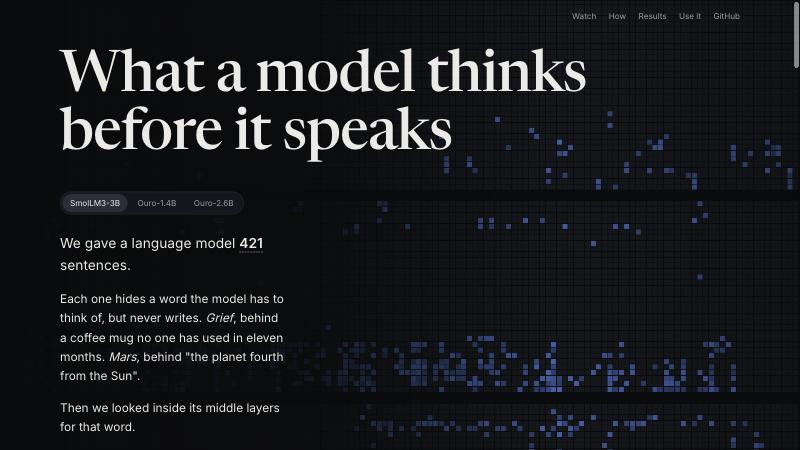

# SP-Lens

**What a language model thinks before it speaks.**

[](https://github.com/thehimalayanleo/sp-lens/actions/workflows/tests.yml)
[](LICENSE)

[](https://thehimalayanleo.github.io/sp-lens/)

**[Open the interactive site →](https://thehimalayanleo.github.io/sp-lens/)** Watch a hidden concept form layer by layer, on real prompts.

Give a model the sentence *"She kept his coffee mug on the counter, washed it every morning and put it back, though no one had used it in eleven months."* It never writes *grief*, but somewhere in its middle layers it is thinking it. SP-Lens reads those words out.

It combines four readouts of each layer (the logit lens, the logit lens at earlier positions, and the fitted J-lens and R-lens transports), removes the noise each one adds, and fuses what is left into one list per layer.

| Hidden concept in a lens's top 10, 421 held-out prompts | SP-Lens | J-lens | R-lens | Logit lens |
|---|---|---|---|---|
| SmolLM3-3B | **50.1%** | 31.8% | 26.1% | 27.8% |
| Ouro-1.4B | **63.7%** | 34.7% | 47.5% | 55.8% |
| Ouro-2.6B | **71.0%** | 39.0% | 49.2% | 62.0% |

Settings were fixed on a development split, then measured once on this confirmation split. "Found" means the labelled concept is in the top 10 at some layer, which is simpler than the benchmark's pass@10 metric.

## Install

```bash
pip install git+https://github.com/thehimalayanleo/sp-lens
```

Or, from a clone, `pip install -e .`. Needs Python 3.10+, PyTorch 2.3+ and Transformers 4.45+.

## Quickstart

Fit the J-lens and R-lens transports once per model. This needs a GPU for models above about 1B parameters, and uses 25 prompts of 128 tokens from NeelNanda/pile-10k:

```bash
splens fit HuggingFaceTB/SmolLM3-3B --out lenses/smollm3
```

Read a prompt, layer by layer:

```bash
splens read HuggingFaceTB/SmolLM3-3B "The capital of the country where the Eiffel Tower stands is" \
  --lens-dir lenses/smollm3 --compare logit j r
```

From Python:

```python
from splens import SPLens, load_model

model, tok = load_model("HuggingFaceTB/SmolLM3-3B")
lens = SPLens(model, tok, "lenses/smollm3")
lens.calibrate()                    # PMI baselines from calibration text
reading = lens.read("Fact: the currency of Japan is")
print(reading.table())              # SP-Lens top 10 per layer
```

Without `--lens-dir`, SP-Lens uses its J-free arm (logit lens plus earlier positions), which needs no fitting.

**Supported models:** decoder-only models with `model.layers`, `transformer.h` or `gpt_neox.layers`. The R-lens needs RMSNorm and a gated MLP (Llama, Qwen, SmolLM, OLMo and similar). Looped models such as Ouro work; use `--stride 4` to fit every fourth layer.

## How it works

At each source layer there are four lists of vocabulary scores: the logit lens, the logit lens at earlier positions (max over positions 4 to p-1), and the fitted J-lens and R-lens transports. Each list is PMI-corrected against calibration text, deduplicated by surface form, and stripped of prompt tokens. The lists are then fused with weights R 1.0, J 0.25, logit 0.25 and earlier positions 0.5, scored as weight / rank, with a penalty of 0.35 per earlier layer that already showed the token (capped at 3). These are the SPLENS-V4 "JR+prev" settings, fixed on the development split before the confirmation numbers above. The R-lens changes only the backward rules of RMSNorm and the gated MLP; `splens fit` refuses to run if those rules change the forward logits.

## Limits

- SP-Lens still uses the J-lens and R-lens as candidate generators, so it does not replace them.
- It does not win at every layer.
- Poetry-planning concepts stay near zero for every lens.
- An agreement-gated variant replicated on Qwen 27B models but tied on SmolLM2-1.7B and OLMo2-1B.
- The library matches the research harness on about 91% of displayed tokens across hardware: the same algorithm and numerically close, but not bit-identical. See [docs/parity.md](docs/parity.md).

## Repository

| Path | What |
|---|---|
| `src/splens/` | the library and the `splens` CLI |
| `tests/` | CPU smoke tests on a random tiny Llama: `pytest -q tests` |
| `site/` | the landing page and the concept library page |
| `demo/` | the keywords demo: all 421 prompts, every lens, every layer |
| `scripts/` | data exports for the pages (`landing_data.py`, `demo_page_data.py`, `demo_keywords.py`) |

To view the site locally, copy it into the same layout as GitHub Pages:

```bash
mkdir -p _site && cp -r site/* _site/ && cp -r demo _site/demo
python3 -m http.server 8000 --directory _site
```

`scripts/demo_keywords.py` exports per-layer token lists for each lens. It runs inside the SP-Lens research codebase and needs the fitted V4 lenses. `scripts/demo_page_data.py` turns an export into the compact file the demo reads. Keywords never see the labels: only word-like tokens, tokens that appear for 5% or more of prompts are dropped, and each token scores 1/rank × log(prompts ÷ prompts containing it), summed over layers.

## Citation

See [CITATION.cff](CITATION.cff), or use GitHub's "Cite this repository" button.

MIT licensed.
